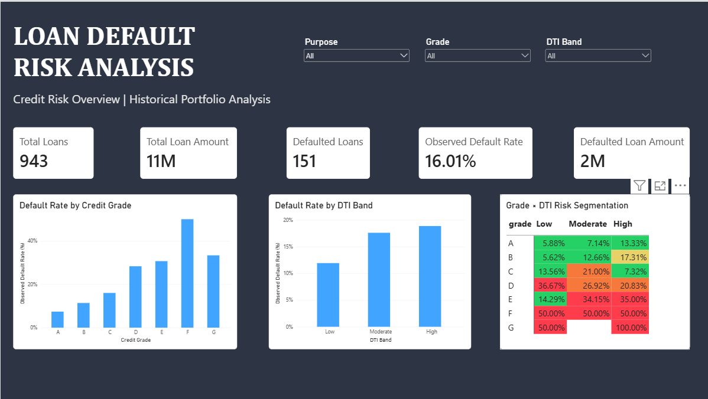
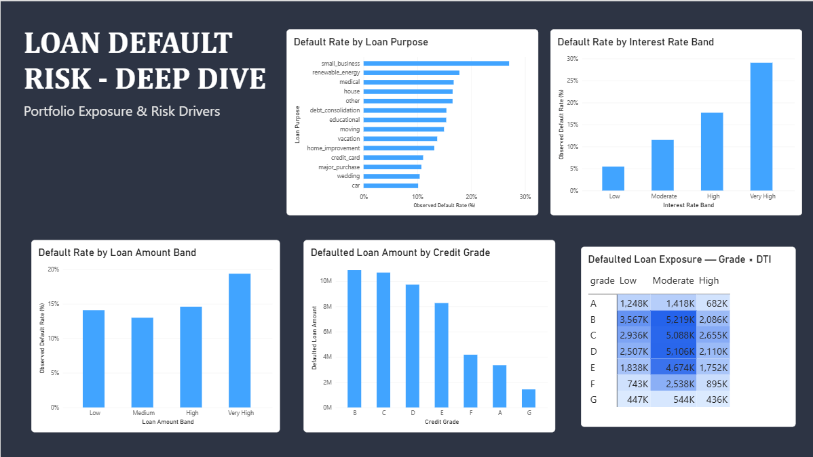

# Loan Default Risk Analysis: Identifying Credit Risk & Defaulted Loan Exposure

   **TL;DR:** Analyzed 27,003 loans and found a 14.73% observed default rate. Default rates rise from 6.11% (Grade A) to 34.25% (Grade G), and hypothesis tests (chi-square, two-proportion z-test; p < 0.001) confirm that credit grade and interest rate are significantly associated with default.

## Table of Contents
- [Project Overview](#project-overview)
- [Data Source](#dataset-source)
- [Business Problem](#business-problem)
- [Project Objectives](#project-objectives)
- [Dataset Overview](#dataset-overview)
- [Tools and Technologies](#tools-and-technologies)
- [Project Workflow](#project-workflow)
- [Key Performance Indicators](#key-performance-indicators)
- [Key Findings](#key-findings)
- [Power BI Dashboard](#power-bi-dashboard)
- [Business Recommendations](#business-recommendations)
- [Project Structure](#project-structure)
- [How to Run the Project](#how-to-run-the-project)
- [Limitations](#limitations)
- [Future Improvements](#future-improvements)

## Project Overview

This project analyzes historical loan data to identify patterns associated with loan defaults, assess credit-risk segments, and evaluate defaulted loan principal exposure.

The analysis combines SQL, Python, and Power BI to examine borrower credit grades, debt-to-income (DTI) ratios, interest rates, loan amounts, and loan purposes.

The goal is to translate historical loan data into actionable insights that can support portfolio monitoring and credit-risk assessment.

## Dataset Source

- **Source:** [Kaggle — Loan Default Prediction](https://www.kaggle.com/competitions/loan-default-pred)
- **File used:** `loan_train.csv`
- **Description:** Historical loan applicant and loan-status data used to analyze default patterns across credit grades, debt-to-income ratios, interest rates, loan amounts, and loan purposes.
- **License:** Subject to Kaggle competition rules. Refer to the original competition page for applicable terms.
- **Data availability:** The dataset is not included in this repository. Users must obtain it from the original source and comply with its applicable terms.

## Business Problem

Lenders need to understand which borrower segments exhibit higher observed default rates and which categories contribute most to defaulted loan principal exposure.

This project investigates the following questions:

- What proportion of loans in the dataset are classified as defaults?
- How do observed default rates vary across credit grades?
- How are defaults associated with DTI and interest-rate bands?
- Which loan amount bands and loan purposes show higher observed default rates?
- Which credit grades and loan purposes contribute most to defaulted principal exposure?
- How can these findings inform portfolio monitoring?

## Project Objectives

- Analyze loan performance using SQL.
- Perform data-quality checks and exploratory data analysis in Python.
- Create risk bands for loan amount, DTI, and interest rate.
- Compare observed default rates across individual and combined risk segments.
- Build an interactive Power BI dashboard.
- Develop business recommendations based on the findings.
- Validate key metrics across SQL, Python, and Power BI.

## Dataset Overview

The project uses a loan dataset containing **27,003 records and 47 columns**.

| Dataset Metric | Value |
|---|---:|
| Total loan records | 27,003 |
| Unique loan IDs | 27,003 |
| Non-defaulted loans (`loan_status = 0`) | 23,026 |
| Defaulted loans (`loan_status = 1`) | 3,977 |
| Observed default rate | 14.73% |
| Total original loan principal | 299,407,825 |
| Original principal associated with defaulted loans | 48,489,975 |

*Note: The source dataset does not specify a currency, so principal amounts are shown in the dataset's native units.*

### Target Variable

- `loan_status = 0`: Non-defaulted loan.
- `loan_status = 1`: Defaulted loan.

The observed default rate is calculated as the number of defaulted loans divided by the total number of loans.

## Tools and Technologies

- **MySQL:** Data validation, aggregation, segmentation, and analytical queries.
- **Python:** Data inspection, data-quality analysis, feature engineering, exploratory data analysis, and visualization.
- **Pandas and NumPy:** Data manipulation and numerical analysis.
- **Matplotlib:** Charts and heatmap visualization.
- **Power BI:** Interactive dashboard development and KPI reporting.
- **Jupyter Notebook:** Documenting and executing Python analysis.
- **Git and GitHub:** Version control and project documentation.
- **SciPy and statsmodels:** Hypothesis testing and confidence intervals

## Project Workflow

1. Loaded and inspected the loan dataset.
2. Validated row counts, unique identifiers, and target-variable distribution.
3. Examined missing values and data quality.
4. Created risk categories for DTI, interest rate, and loan amount.
5. Analyzed default rates by credit grade, DTI, interest rate, loan amount, and loan purpose.
6. Examined combined credit-grade and DTI segments.
7. Calculated defaulted principal exposure by credit grade and loan purpose.
8. Built a multi-page Power BI dashboard.
9. Cross-checked overall portfolio metrics between SQL and Python and verified that the Power BI dashboard reports the same key metrics.
10. Prepared findings, limitations, and business recommendations.

## Key Performance Indicators

- Total Loans
- Non-Defaulted Loans
- Defaulted Loans
- Observed Default Rate
- Total Loan Principal
- Defaulted Loan Principal

**Important distinction:** Defaulted loan principal is the sum of the original loan amounts for defaulted accounts. It is not the same as actual lender losses, outstanding balances, or loss given default.

## Key Findings

- **Overall portfolio:** Analyzed 27,003 loans, including 3,977 defaults, resulting in an observed default rate of 14.73%.
- **Credit grade:** Observed default rates increased from 6.11% for Grade A to 34.25% for Grade G, a difference of 28.14 percentage points.
- **DTI:** Default rates increased from approximately 12.82% in the Low DTI band to 17.27% in the High DTI band. The pattern varied across credit grades.
- **Interest rate:** Loans with interest rates below 12% had a 9.16% default rate, compared with 21.19% for loans at or above 12%—a difference of 12.03 percentage points.
- **Loan amount:** The Very High loan amount band had the highest observed default rate at 19.37%, compared with 13.00% in the Medium band.
- **Loan purpose:** Debt consolidation contributed the largest defaulted principal exposure among loan purposes. 
- **Combined segmentation:** Analyzing credit grade and DTI together revealed differences in observed default rates across borrower segments.
- **Statistical testing:** A chi-square test showed credit grade is significantly associated with default (χ² = 1122.06,  df = 6, p < 0.001). A two-proportion z-test showed default rates of 9.16% (interest rate below 12%) vs 21.19% (12% or above), p < 0.001. The 95% confidence interval for the overall default rate is 14.31% to 15.16%.

These findings describe observed historical associations and do not establish causation.

## Power BI Dashboard

The Power BI report presents an overview of loan performance and a deeper analysis of default risk.

### Page 1: Loan Default Risk Analysis

Includes portfolio KPIs, observed default rates by credit grade and DTI band, a credit-grade-by-DTI risk matrix, and interactive slicers.



### Page 2: Loan Default Risk Deep Dive

Includes analysis of loan purposes, interest-rate bands, loan amount bands, and defaulted principal exposure across credit grades.



## Business Recommendations

1. **Monitor credit-grade risk:** Review underwriting and portfolio performance across credit grades with higher observed default rates.
2. **Combine risk indicators:** Assess DTI alongside credit grade and other available borrower information rather than relying on one variable alone.
3. **Monitor interest-rate segments:** Investigate higher-default-rate interest bands while accounting for borrower characteristics and loan terms.
4. **Track principal exposure:** Monitor both observed default rates and the original principal associated with defaults.
5. **Review loan-purpose exposure:** Investigate categories that contribute substantial defaulted principal, including debt consolidation.
6. **Validate segment sizes:** Review loan counts alongside default rates, especially for small segments, before making policy decisions.

These recommendations are analytical suggestions, not proof that changing a particular lending policy will reduce defaults.

## Project Structure

```text
Loan-Default-Risk-Analysis/
│
├── Data/
│   └── loan_train.csv  (not included; download from Kaggle)
│
├── Images/
│   ├── loan_risk_overview.png
│   └── loan_risk_exposure.png
│
├── Notebook/
│   ├── loan_default_risk_analysis.ipynb
    └── loan_default_statistical_analysis.ipynb
│
├── SQL/
│   └── loan_default_analysis.sql
│
├── Dashboard/
│   └── loan_default_risk_analysis.pbix
│
├── .gitignore
├── .gitattributes
├── requirements.txt 
└── README.md
```

## How to Run the Project

### SQL Analysis
1. Set up a MySQL database.
2. Import the dataset into a table with compatible column types.
3. Open `SQL/loan_default_analysis.sql`.
4. Execute the queries against the full dataset.

### Python Analysis
1. Install Python and Jupyter Notebook.
2. Install the required libraries:

   ```bash
   pip install -r requirements.txt
   ```

3. Download `loan_train.csv` from the Kaggle competition page and place it in a `Data/` folder at the project root.
4. Open `Notebook/loan_default_risk_analysis.ipynb` for the exploratory analysis.
5. Open `Notebook/loan_default_statistical_analysis.ipynb` for the hypothesis tests.
6. Run the cells in each notebook in order.  

### Power BI Dashboard
1. Open `Dashboard/loan_default_risk_analysis.pbix` in Power BI Desktop.
2. Configure the data source if necessary.
3. Refresh the report after verifying the underlying dataset.

## Limitations

- The analysis is based on historical data and does not establish causal relationships.
- Observed default rates may vary with sample size and the characteristics of the dataset.
- Small segments may produce unstable default-rate estimates.
- Defaulted original principal is not a measure of realized financial loss.
- Results may not generalize to other lenders, products, or time periods.
- The dataset's definitions and coverage should be verified before using the findings in real lending decisions.

## Future Improvements

- Explore logistic regression or other predictive methods for default-risk estimation.
- Evaluate model performance using appropriate validation methods.
- Investigate additional borrower characteristics and repayment behavior.
- Add time-based portfolio trends if reliable origination and repayment dates are available.
- Extend the analysis with explainability and model-monitoring techniques.

---

**Project focus:** Credit-risk analysis, loan default segmentation, SQL analytics, Python EDA, and Power BI reporting.
